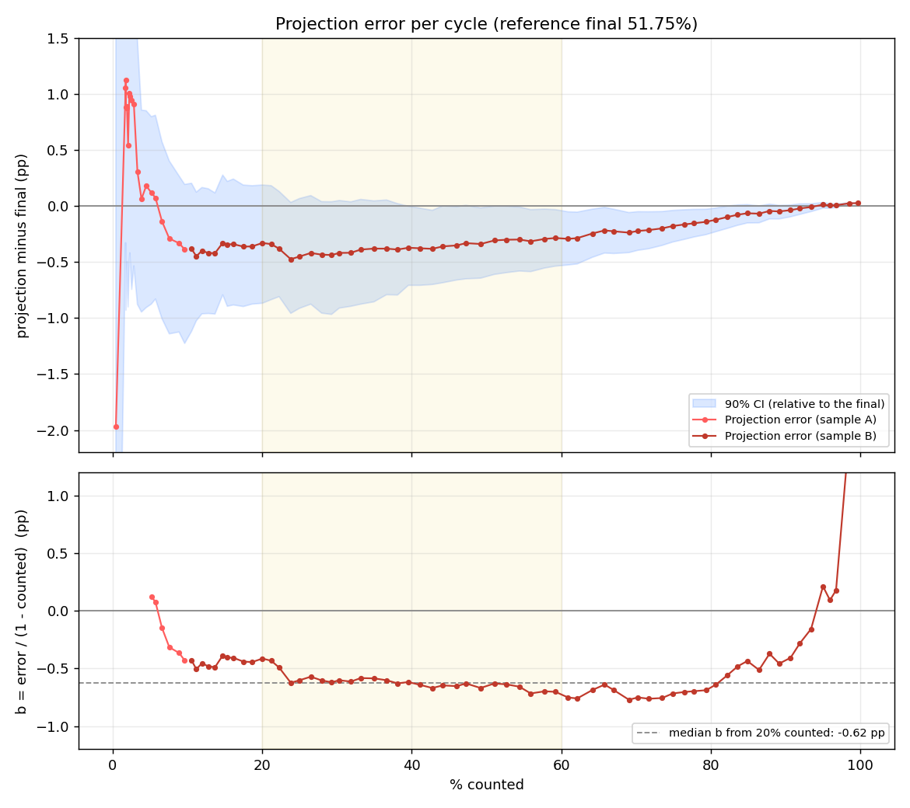

> **Unofficial statistical estimate built for study; not affiliated with the TSE. Results here are not official.**

# Second-round projection: Brazilian presidential election 2026

Live projection of the second-round (R2) result from the TSE (Superior Electoral Court) partial count, anchored on the first-round (R1) result per municipality (weighted ridge regression on empirical logits, with UF and region effects, and a bootstrap by UF for the interval). UF = federative unit (state).

Full documentation: [docs/METHODOLOGY.md](docs/METHODOLOGY.md).

## Results

Election night of 2026-10-25: 85 usable cycles. The reference final is **51.75%** for A, the raw count at 99.65% counted (the official result is not incorporated yet).

- From 1.7% counted on, the projection had A ahead in every cycle (84 cycles; the lowest 90% CI bound was 50.52%), and from 3.3% counted it stayed within 0.5 pp of the final (largest error 0.48 pp).
- **Main finding:** a stable underestimate of the remaining vote of about 0.65 pp, from ~20% to ~80% counted (the implied bias `b` has mean -0.65 pp and median -0.64 pp over that range). The 90% CI covered the final in only 3 of 29 cycles between 39.5% and 84% counted: the bootstrap captures variance, not bias. The leading hypothesis (untested) is in [docs/METHODOLOGY.md](docs/METHODOLOGY.md).



## Layout

| File | Role |
|---|---|
| `scenario_t1.py` | Builds the R1 base (`cenario_municipio.csv`, `cenario_zona.csv`) from the TSE zip |
| `projection_r2.py` | Live R2 ingestion + model + bootstrap |
| `dashboard_html.py` | Builds `dashboard.html` with the real-time projection |
| `build_uf_svg.py` | Builds `br_uf_svg.json` (map by UF) |
| `legacy_state_swing.py` | First approach, swing in the UFs already counted (legacy, discarded) |
| `diag_overestimation.py`, `diag_pst.py` | Offline diagnostics |
| `test_synthetic.py` | Offline test with synthetic data |
| `cenario_municipio.csv`, `cenario_zona.csv` | R1 base per municipality / electoral zone (versioned, avoids downloading the 450 MB zip) |
| `data/election_night_2026-10-25/` | Recorded election night (2026-10-25): `historico.csv`, `ultimo_snapshot.csv`, `logs/watch.log`; original names kept |
| `docs/` | Methodology and evaluation (`error_by_cycle.py` reads the recorded folder and regenerates the tables and plot) |

Scripts use relative paths and import each other: run everything from the project root.

## Quick start

```powershell
pip install -r requirements.txt
python test_synthetic.py
python -u projection_r2.py --e2 6258 --A 13 --B 22 --gate-only
python -u projection_r2.py --e2 6258 --A 13 --B 22 --watch
python dashboard_html.py --A "Lula" --B "Flavio"
```

## Replay election night

Rebuild the dashboard from the recorded count (no network needed):

```powershell
python dashboard_html.py --dir data/election_night_2026-10-25 --A "Lula" --B "Flávio" --once
```

This writes `dashboard.html` (git-ignored) in the current directory; `br_uf_svg.json` is still read from the project root. `projection_r2.py --watch` polls the TSE live feed, so it only works during a live count; the replay uses the recorded files instead.

## Data sources

- **First-round base (`dados_tse_2026/`)**: TSE Open Data, dataset [Resultados 2026](https://dadosabertos.tse.jus.br/dataset/resultados-2026). The file used is the candidate votes by municipality and zone, downloaded from the TSE CDN: `https://cdn.tse.jus.br/estatistica/sead/odsele/votacao_candidato_munzona/votacao_candidato_munzona_2026.zip`. Save it as `dados_tse_2026/munzona_2026.zip`, the default path of `scenario_t1.py`, which reads `votacao_candidato_munzona_2026_BR.csv` from inside it. The TSE republishes this file: the copy used on election night had 452,159,174 bytes, while the CDN file on 2026-10-27 had 456,373,976 bytes. The base actually used is versioned in `cenario_municipio.csv` and `cenario_zona.csv`.
- **Live second-round results**: the TSE results feed (`https://resultados.tse.jus.br/oficial`, see `BASE` in `projection_r2.py`), read by `projection_r2.py`; no setup needed.
- **State boundaries (`dados_geo/`, optional)**: `dados_geo/brazil-states.geojson` from `https://raw.githubusercontent.com/codeforamerica/click_that_hood/master/public/data/brazil-states.geojson` (byte-identical to the file used). It is only needed to rebuild `br_uf_svg.json` with `build_uf_svg.py`; `br_uf_svg.json` is committed.

## Not versioned (see `.gitignore`)

`dados_tse_2026/` (450 MB zip, download from the TSE Open Data portal), `cache/`, `dados_geo/`, logs and `dashboard.html` (run output). The projector writes `historico.csv` and `ultimo_snapshot.csv` to the working directory (also not versioned); the versioned record of the 2026-10-25 count is `data/election_night_2026-10-25/`.

## Fixed identifiers

Some names are data contracts and are intentionally kept in Portuguese: CSV column names (`A1`, `B1`, `O1`, `V1`, `A2`, `B2`, `pst`, `p_hat`, `R`, `Vhat`, `status`, `div_br`, `apurado`, ...), TSE JSON fields, status values (`ok`, `nao_ancorado`, `inconsistente`) and the data file names above. See the glossary in [docs/METHODOLOGY.md](docs/METHODOLOGY.md#13-glossary-and-fixed-identifiers).
